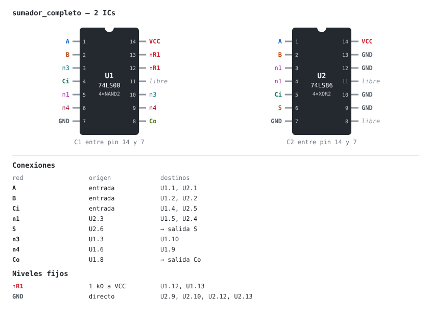

# ttl-designer

Herramienta para diseñar circuitos combinacionales con compuertas TTL 74LS: de una expresión
booleana a un circuito montable, con minimización, mapeo a chips reales, simulación,
esquemático SVG, BOM y documentación por etapa.

Licencia [MIT](LICENSE). Para contribuir, ver [CONTRIBUTING.md](CONTRIBUTING.md).

## Documentación

- [`docs/decisions/`](docs/decisions/README.md): decisiones de diseño y su porqué.
- [`CATALOG_CONTRACT.md`](CATALOG_CONTRACT.md): especificación del catálogo de chips 74LS.
- [`CLAUDE.md`](CLAUDE.md): manual de operación e invariantes (para agentes y mantenedores).

## Estado

Núcleo lógico (combinacional), independiente del catálogo de chips:

- `ttl_designer/logic/parser.py` — expresiones booleanas → AST (`Y = A B' + C`)
- `ttl_designer/logic/truthtable.py` — tablas de verdad bit-paralelas (hasta 16 entradas)
- `ttl_designer/logic/qm.py` — Quine-McCluskey + Petrick con traza por etapa
- `ttl_designer/logic/build.py` — ecuaciones → netlist lógico con hashing estructural
- `ttl_designer/models/netlist.py` — netlist validado (drivers únicos, sin lazos, niveles)
- `ttl_designer/sim/functional.py` — simulación sin retardo y verificación de equivalencia
- `ttl_designer/models/catalog.py` — esquema y validación de `library/ttl_ls_catalog.json`

Mapeo a chips 74LS (`ttl_designer/techmap/`): cinco estrategias (mixta, NAND, NOR,
NAND+XOR, NOR+XOR) sobre la forma minimizada y la original, absorción de compuertas
sueltas en ranuras libres y asignación a chips y pines. Elige por número de ICs.

## Vista de chips

Sumador completo mapeado a 7400 + 7486, con el pinout etiquetado y la tabla de conexiones:



## API

| ruta | qué hace |
|---|---|
| `POST /api/analyze` | tabla de verdad, minimización con traza, netlist lógico |
| `POST /api/map` | candidatos por estrategia, diseño elegido (chips, pines, entradas fijas), DRC y BOM |
| `POST /api/bom/export?format=csv\|json` | BOM del diseño elegido como archivo descargable |
| `POST /api/render/chips.svg` | vista de chips: pinout etiquetado y tabla de conexiones |
| `GET /health` | estado, versión y commit desplegado |

Documentación interactiva en `/docs` con el servidor corriendo.

## Sintaxis de expresiones

| Operación | Símbolos                         |
|-----------|----------------------------------|
| NOT       | `A'` `!A` `~A` `¬A`              |
| AND       | `A·B` `A*B` `A&B` `A B` `A(B+C)` |
| XOR       | `A^B` `A⊕B`                      |
| OR        | `A+B` `A|B`                      |

Precedencia: NOT > AND > XOR > OR. Los identificadores admiten varios caracteres
(`AB` es una variable). Varias salidas se separan con `;` o salto de línea.

## Desarrollo

```bash
python -m venv .venv && .venv/bin/pip install -e '.[dev]'
.venv/bin/pre-commit install
.venv/bin/pytest
.venv/bin/uvicorn ttl_designer.app:app --reload   # http://127.0.0.1:8000/docs
```
